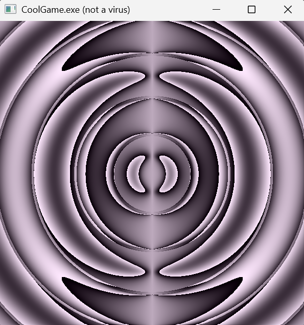

# OsenEngine

OsenEngine is a game engine I am writing to get better at programming.

## about OsenEngine
OsenEngine is a work-in-progress game-engine (just like this README). 
In its current state you can quite literally do nothing with it. 
The only thing it currently only displays the animated shader art you see below.


## building

### requirements

- a c++ compiler with c++20 support
- CMake 3.13 or later
- The Vulkan SDK with Vulkan 1.4 support and the Slang compiler

### build steps

1. Clone the repo and submodules:
```sh
git clone https://github.com/ThreeBoats/OsenEngine.git --recursive
cd OsenEngine
```
2. Compile the program using CMake:
```sh
cmake -S . -B build
cmake --build build
```
3. Compile the shaders with Slang:

```sh
slangc.exe shader.slang -target spirv -profile spirv_1_4 -emit-spirv-directly -fvk-use-entrypoint-name -entry vertMain -entry fragMain -o slang.spv
```

Put the `slang.spv` file it produces in the executable's working directory. 

If you are not sure about the working directory, you can find it by running the program.
In the console log the working directory will be printed.

**note:** shader compilation will be improved in the future. 
This is only a temporary solution.

4. Run the program!
## project structure
Coming soon<sup>tm</sup>
## roadmap
Coming soon<sup>tm</sup>
## license
**All rights reserved!** Until the time there is a proper license, you cannot use this program freely.
You can 'use' it for personal uses, Even though I do not really see a use for it yet;)

## trivia
1. the osen part of OsenEngine was chosen by generating a lot of variations of random letters and choosing the first combination that is pronounceable.